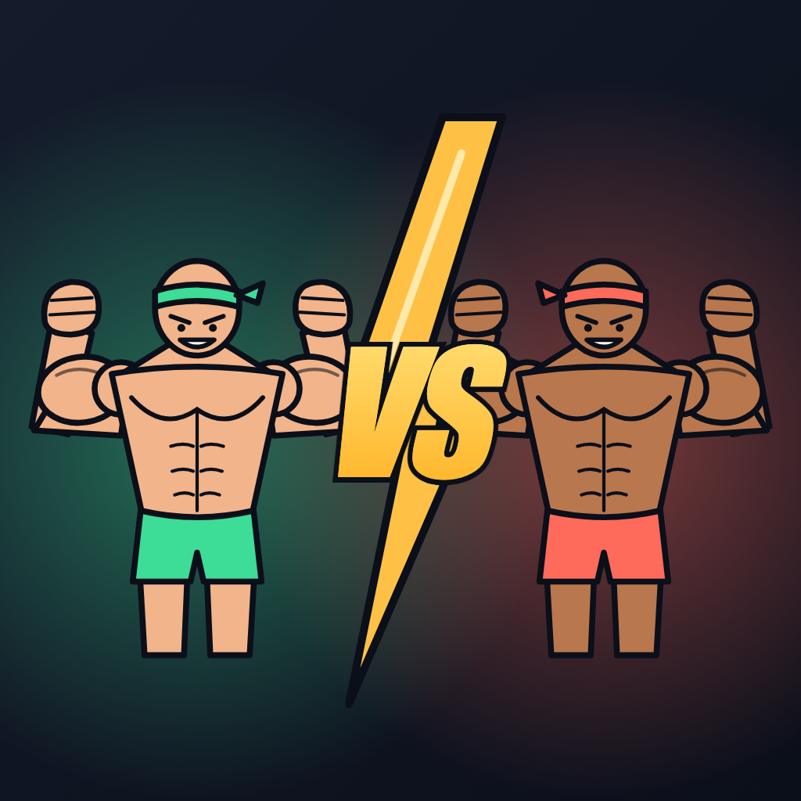

<p align="center"></p>

# Dawshia Mobile

A competitive bodyweight-training app: the phone camera watches you, counts every valid rep on the device, and turns workouts into chess-style timed matches.

**Current scope:** offline practice mode with:
- **Most reps in a time control:** push-ups, pull-ups, deep parallel-bar dips, muscle-ups and handstand push-ups.
- **Resistance (longest hold wins):** handstand, L-sit and front lever. The code is structured so that more exercises and online 1v1 (through `dawshia-server`) can be added without restructuring.

## Run it

The camera and on-device ML need native code, so the app does **not** run in Expo Go, and the camera doesn't work in simulators. Use a real phone.

```sh
npm install
npm run ios       # or: npm run android   (builds a dev client and installs it)
npm start         # later runs: just start Metro
```

`npm run ios` needs Xcode and CocoaPods. `npm run android` needs Android Studio. You can also build in the cloud with `npx eas-cli@latest build --profile development`.

Other scripts: `npm test` · `npm run typecheck` · `npm run lint`

### Install a standalone app (release build)

A development build loads its JavaScript (and the pose model) from Metro over Wi-Fi, so it opens slowly. For everyday use, install a release build instead. It contains everything and doesn't need your computer:

```sh
npx expo prebuild --platform android --clean   # only after app.json / native changes
npm run android:release                        # builds, installs and opens it on the connected phone
```

The APK is in `android/app/build/outputs/apk/release/`. It's signed with the debug key, which is fine for your own phones. Publishing to Google Play needs your own upload key.

## How it works

```
Camera frame (YUV)
  └─▶ GPU resize + rotate + letterbox to 192×192 RGB   (react-native-vision-camera-resizer)
      └─▶ MoveNet Lightning pose model (TFLite, CPU)     (react-native-fast-tflite)
          └─▶ 17 keypoints ─▶ JS thread
              └─▶ ExerciseAnalyzer (push-up rules) ─▶ rep / rejected-rep events
                  └─▶ matchReducer (clock + score) ─▶ UI  (+ MatchTransport → server, later)
```

All frame processing runs on the camera thread (worklets). Video never leaves the phone.

## Project structure

```
src/
  app/                        Expo Router screens (thin; just wiring)
    index.tsx                 menu step 1: pick the movement
    exercise/[exerciseId].tsx menu step 2: pick one of that movement's competition types
    settings.tsx              language, cheer sounds, server address
    profile.tsx               reps per movement: today / this month / total (+ ranked ratings)
    session/[exerciseId].tsx  live session
    results.tsx               after-match summary
  core/                       pure TypeScript, no React or native code — unit tested
    pose/                     model-agnostic Pose type, geometry, smoothing
    exercises/
      types.ts                ExerciseDefinition / ExerciseAnalyzer interfaces
      repStateMachine.ts      reusable rep detector (start → far → start)
      registry.ts             list of available exercises
      pushup/                 push-up rules (side view, landscape)
      pullup/                 pull-up rules (front view, portrait)
      muscleup/               muscle-up rules (front view, portrait, room above the bar)
      dip/                    deep dips (side view; shoulder must go below the elbow)
      handstandpushup/        handstand push-ups (side view; head near the floor)
      handstand/              handstand hold (inverted, arms locked, body vertical)
      lsit/                   L-sit hold (arms locked, torso upright, legs horizontal)
      frontlever/             front lever hold (hanging, body straight and horizontal)
      holdAnalyzer.ts         shared hold timing (grace period, hold length) for all holds
    match/                    time controls, match state machine, scoring
  features/
    audio/                    voice cheers after each valid rep (assets/sounds/cheers/<lang>/)
    pose/                     camera → keypoints pipeline, MoveNet decoder, skeleton overlay
    session/                  useMatchSession (pose → analyzer → match) + HUD components
    settings/                 device preferences (language), saved to a JSON file
  services/                   BACKEND BOUNDARY
    types.ts                  Auth / Matchmaking / MatchTransport / History interfaces
    local/                    offline implementation (history saved in a JSON file on the device)
    remote/                   Dawshia server (Nakama REST): profile + practice sync, falls back to local
    ServicesProvider.tsx      picks the implementation
  i18n/                       translations (fa default, en), RTL + digit helpers
  ui/                         theme, shared components and hooks
assets/models/                TFLite models
```

## Add a new exercise

1. Create `src/core/exercises/<name>/`.
2. Implement an `ExerciseAnalyzer`. Most exercises can reuse `RepStateMachine` with a joint-angle signal:
   - squat: knee angle, `startZone: 'high'`
   - pull-up: elbow angle, `startZone: 'low'`
3. Export an `ExerciseDefinition` with its camera setup (orientation and view) and the competition types it offers (`competitions`). The menu only shows those types, so a movement like a handstand can offer a single type.
4. Add it to the list in `src/core/exercises/registry.ts`.
5. Add its texts under `exercises.<id>` (name, description, setup instructions), plus any new form-cue codes under `cues`, in **every** file in `src/i18n/messages/`. TypeScript reports any missing keys.
6. Add tests using the synthetic pose helpers in `src/core/pose/testing/`.

Nothing in `features/`, `app/` or `services/` needs to change.

## Languages

Persian (`fa`, right-to-left) is the default; English (`en`) can be picked in **Settings** (the ⚙ button on the home screen). The choice is saved on the device.

- All UI text lives in `src/i18n/messages/`. `fa.ts` defines the shape, and every other language must match it, which TypeScript checks.
- Core logic never contains display text: exercises, cues and time controls expose only ids/codes, and the UI looks up their text (`src/i18n/lookup.ts`).
- In components, use `const { m, f, n, dir, textStart } = useI18n()`:
  - `m`: the messages
  - `f`: fills placeholders
  - `n`: localizes digits (۱۲۳)
  - `dir`: put it on the screen's root view for RTL layout
  - `textStart`: start-aligned text
- To add a language: create `src/i18n/messages/<id>.ts` typed as `Messages` and register it in `src/i18n/locales.ts`.

## Accounts, profile and server

- **Login:** on launch the app shows a sign-in / sign-up screen (email + password, via Nakama's email auth).
  - The session is saved on the phone and refreshed automatically, so you stay signed in for 30 days of inactivity.
  - **Continue offline** skips the account. Practice still works, and stats stay on the phone.
- **Server address:** hard-coded in `src/services/remote/config.ts` (`SERVER_URL`, currently `http://192.168.1.105:7350`). TODO: make it configurable per build and use HTTPS for release builds.
- **Profile** (👤 on the home screen): each movement's valid reps **today**, **this month** and **in total**.
  - Signed in, it reads from the server, and every finished practice session is sent there.
  - Offline, or when the server is unreachable, it uses the history saved on the phone and shows the technical reason.
- **Debugging the connection:** Settings → Server → **Test connection** shows the round-trip time or the exact error. Network failures are also logged as `[dawshia] …` warnings (`adb logcat | grep dawshia`).
- **Code:**
  - `src/features/auth/`: session, refresh, login state
  - `src/services/remote/`: Nakama API client and server-backed services
  - `src/app/login.tsx`: the login screen
- **Known limit:** the session is stored in the app's private files, not the OS keychain. Moving it to `expo-secure-store` needs a native rebuild.

## Connect the backend for 1v1

Screens and hooks only use the interfaces in `src/services/types.ts`. To go online:

1. Add `src/services/remote/` implementing the same interfaces with the Nakama JS client (`@heroiclabs/nakama-js`):
   - `MatchmakingService.findMatch` → Nakama matchmaker
   - `MatchTransport` → real-time match socket
2. Return it from `ServicesProvider` when online.
3. Opponent rep events arrive through `MatchTransport.subscribe` and feed the same `matchReducer`. The second score bar slot in `SessionScreen` is already reserved for them.

## Competition formats

Each exercise lists its competition types (`competitions` in its definition). Each type has a **format** (`src/core/match/timeControls.ts`):

| Format | Types | Score | Ends when |
|---|---|---|---|
| `timedReps` | Bullet 1 min, Blitz 3 min, Rapid 5 min, Endurance 10 min | valid reps | the clock runs out |
| `maxHold` | Resistance (10 min cap) | seconds held | the hold breaks (or the cap is reached) |

How a hold works:
- The countdown starts as soon as the athlete is visible.
- The hold timer runs while the analyzer reports `inPosition`.
- Detection drops shorter than 0.6 s don't break the hold.
- A hold earns 2 XP per second, and records, profile totals and server stats are in seconds.

## Match sounds

Timed (rep) competitions get arena-style audio (`src/features/audio/useMatchAudio.ts`):
- **Start:** 3-2-1 countdown beeps, then a start horn.
- **During the match:** a background beat that switches to a faster, louder **intense loop** for the final stretch (the last 15 s of a 1-minute match, the last 30 s of longer ones), plus clock ticks in the final 5 s.
- **End:** a buzzer when time runs out, and a fanfare on the results screen for a new record or level-up.

Resistance holds stay quiet apart from the voice cheers.

All match sounds are original and synthesized by `scripts/generate-sounds.py` (no dependencies; run `python3 scripts/generate-sounds.py` to regenerate or tweak them). Loops are WAV so they repeat without gaps. You can turn them off in Settings → "Match music & effects".

## Cheer sounds

After every valid rep a random voice clip plays in the current language (never the same one twice in a row). Turn it off in Settings.

The Persian clips are generated placeholders. Record your own (a short `.m4a` each) and replace the files in `assets/sounds/cheers/fa/`, keeping the same names. To add clips, list them in `src/features/audio/cheers.ts`.

## Tuning detection

The thresholds are in `PUSHUP_THRESHOLDS` (`src/core/exercises/pushup/pushupAnalyzer.ts`), `PULLUP_THRESHOLDS` (`src/core/exercises/pullup/pullupAnalyzer.ts`) and `MUSCLEUP_THRESHOLDS` (`src/core/exercises/muscleup/muscleupAnalyzer.ts`). During a session, the live elbow angle is shown in the bottom-right corner to help tuning on real devices.

## CI and releases (GitHub)

- **CI** (`.github/workflows/ci.yml`) runs typecheck, lint and tests on every push to `main` and every pull request.
- **Release** (`.github/workflows/release.yml`) builds the Android APK on GitHub and publishes it on **Releases**:
  - **Every push to `master`/`main`** updates the pre-release **"Latest build"**, whose `dawshia-latest.apk` is always the newest build (version `0.1.0-build.<run>`).
  - **Every version tag** creates a proper release with `dawshia-vX.Y.Z.apk`:

    ```sh
    git tag v0.1.0
    git push origin v0.1.0
    ```

  - You can also start a build from the **Actions** tab ("Run workflow").

  The workflow run number is used as the `versionCode`, so every build installs as an update over the previous one. Pushes that only change docs don't trigger a build. Each build is also kept as a downloadable artifact for 14 days.

  Android builds take a while (≈20–40 min on GitHub's runners). Private repos have a monthly Actions-minutes quota, so pushing very often uses it up faster.

### iOS builds

Version tags (and manual "Run workflow" runs) also build an **iOS `.ipa`** on GitHub's macOS runners and attach it to the release. iOS isn't built on every push, because macOS runners cost 10× Actions minutes on private repos.

**Without Apple signing secrets** (the default), the IPA is **unsigned**. Install it on your iPhone with [Sideloadly](https://sideloadly.io) or [AltStore](https://altstore.io), which sign it with your own Apple ID. With a free Apple ID, the app must be re-installed every 7 days.

**With an Apple Developer account** ($99/year), add these repository secrets to get a **signed** IPA:

| Secret | Value |
|---|---|
| `IOS_CERTIFICATE_P12_BASE64` | your *Apple Distribution* (or *Apple Development*) certificate exported from Keychain as `.p12`, then `base64 -i cert.p12` |
| `IOS_CERTIFICATE_PASSWORD` | the `.p12` export password |
| `IOS_PROVISIONING_PROFILE_BASE64` | a provisioning profile for `com.dawshia.app` (Ad Hoc, with your devices' UDIDs), as `base64 -i profile.mobileprovision` |
| `IOS_EXPORT_METHOD` | optional: `release-testing` (Ad Hoc, the default), `debugging` (development) or `app-store-connect` |

The build logic is in `scripts/ci/build-ios.sh`. It signs only the app target manually, so the CocoaPods targets aren't affected.

### Release signing (one-time setup)

Android only installs an update over an existing app if both are signed with the **same key**. Create a release key once and keep it safe; if it's lost, users must uninstall to update.

```sh
keytool -genkeypair -v -keystore dawshia-release.keystore -alias dawshia \
  -keyalg RSA -keysize 2048 -validity 10000
base64 -i dawshia-release.keystore | pbcopy   # copies the keystore as text
```

Add these **repository secrets** (GitHub → Settings → Secrets and variables → Actions):

| Secret | Value |
|---|---|
| `ANDROID_KEYSTORE_BASE64` | the copied base64 text |
| `ANDROID_KEYSTORE_PASSWORD` | the keystore password |
| `ANDROID_KEY_ALIAS` | `dawshia` |
| `ANDROID_KEY_PASSWORD` | the key password |

Without these secrets the release still works, and the APK keeps the debug signature of Expo's template. That's the same key your local builds use, so updates install fine on your own phones, but it isn't suitable for Google Play.

**Never commit the keystore.** `*.jks`, `*.keystore` and `*.p12` files are git-ignored.

> The server address is hard-coded (`src/services/remote/config.ts`). APKs built on GitHub point at `192.168.1.105`, which only works on your home network until a public server exists.

## Design and gamification

**Design system** (`src/ui/`), following the [ui-ux-pro-max](https://github.com/nextlevelbuilder/ui-ux-pro-max-skill) guidelines (style: *Vibrant & Block-based*):
- **Colors:** semantic tokens in `theme.ts` taken from the logo: green = you, red = opponent, gold = rewards. Text contrast is at least 4.5:1.
- **Type:** Barlow Condensed for display numbers and Latin headings; Vazirmatn for Persian and body text (`AppText`).
- **Icons:** one vector family, `MaterialCommunityIcons` via `Icon`. No emoji are used as icons.
- **Touch and motion:**
  - Touch targets are at least 48 dp, and every pressable shows a pressed state without shifting the layout.
  - Animation timing comes from shared `motion` tokens.
  - Animations are skipped when the system asks for reduced motion.
  - Haptics are used only for meaningful moments (`haptics.ts`).

**Gamification** (`src/core/progress/`), all computed from the session history saved on the phone:

| Theory | Feature |
|---|---|
| Self-Determination Theory: competence | XP per valid rep (better form gives more XP), levels with rank titles (Rookie → Legend), progress bars |
| Flow: clear goals | daily rep goal; your personal best shown as a marker on the score bar during a session |
| Flow: immediate feedback | combo counter, haptics on reps and rejected reps, a "New record!" moment, a results screen with XP and level animation |
| Octalysis: ownership | 12 achievements; locked ones stay visible with their goal |
| Octalysis: loss avoidance (gentle) | daily streak with a "train today to keep it" nudge and no penalty |
| Octalysis: unpredictability | random voice cheers, surprise achievement unlocks |
| SDT: autonomy | choose your movement and competition type |
| SDT: relatedness | 1v1 and ranked play (server) |

Tune the numbers in `src/core/progress/xp.ts` (XP and level curve) and `progress.ts` (daily goal, achievements).

## Logo and icons

The logo is hand-written vector art: `assets/brand/logo.svg`, plus `icon-foreground.svg` and `icon-background.svg` for Android's adaptive icon. To change it, edit the SVG and re-export the PNGs in `assets/` (icon, adaptive icon layers, monochrome, splash, favicon) at 1024 px. The adaptive foreground keeps its art inside the central 66% safe zone.

## License

[MIT](LICENSE) © 2026 Hossein Lookzadeh
